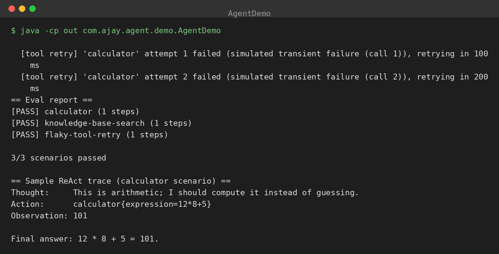

# agent-toolkit

A minimal LLM agent loop with tool calling in Java: tool registry, ReAct-style
Thought → Action → Observation loop, retry-with-backoff on tool calls, and an eval
harness that scores scripted scenarios. Runs fully offline with a mock model.
Zero dependencies.

## The problem

Agent demos usually skip the two parts that decide whether an agent survives
production: **what happens when a tool call fails** (retry? give up? tell the user?),
and **how you know a change didn't break behavior** (evals). This repo is those two
parts, with the smallest agent loop that makes them meaningful.

## What's here

- **`Tool` / `ToolRegistry`** — the tool contract (`name`, `description`, `call`)
  and a named registry with prompt-ready `describe()`.
- **`ModelAdapter`** — the model behind an interface: `next(history, tools)` returns
  either `FinalAnswer` or `ToolCall(thought, toolName, args)`. `ModelAdapter.Mock`
  scripts the "model" with a function, so scenarios are deterministic and offline.
- **`AgentLoop`** — the ReAct loop. Records every Thought → Action → Observation
  step into a trace. Tool calls go through exponential-backoff retries; a tool that
  fails every attempt becomes an `ERROR:` observation and the model decides the
  recovery.
- **`EvalHarness`** — scripted scenarios with assertions on the tool-call sequence
  and the final answer. Prints a PASS/FAIL report.
- **Tools** — `CalculatorTool` (hand-written expression parser — deliberately not
  `ScriptEngine`, so model-generated input can't execute arbitrary code),
  `SearchTool` (keyword search over an in-memory doc set), `FlakyTool` (fails N
  times, then succeeds — proves the retry path).

## Design decisions

- **The loop doesn't know what a model is.** `ModelAdapter` is the seam: mock it for
  evals, implement it against an API for production. Nothing else changes.
- **Retries live under the tool call, not in the model.** The model never sees
  transient failures — it sees the tool's eventual result. Only terminal failure
  becomes an observation.
- **Evals assert behavior, not wording.** Tool sequence + expected substrings in the
  final answer. Deterministic with the mock; run N times and track pass rate with a
  real model.
- **No `ScriptEngine` anywhere near model input.** The calculator parses arithmetic
  with a recursive-descent parser. Small thing, real principle: never give the model
  a code-execution primitive you didn't mean to.

## Project structure

```
src/com/ajay/agent/
  Tool.java  ToolException.java  ToolRegistry.java
  ModelAdapter.java  AgentLoop.java
  tools/CalculatorTool.java  tools/SearchTool.java  tools/FlakyTool.java
  eval/EvalScenario.java  eval/EvalResult.java  eval/EvalHarness.java
  demo/AgentDemo.java
```

## Build & run (Java 17+, no dependencies)

```bash
cd agent-toolkit
javac -encoding UTF-8 -d out $(find src -name '*.java')
java -cp out com.ajay.agent.demo.AgentDemo
```

## Example output

```
  [tool retry] 'calculator' attempt 1 failed (simulated transient failure (call 1)), retrying in 100 ms
  [tool retry] 'calculator' attempt 2 failed (simulated transient failure (call 2)), retrying in 200 ms
== Eval report ==
[PASS] calculator (1 steps)
[PASS] knowledge-base-search (1 steps)
[PASS] flaky-tool-retry (1 steps)

3/3 scenarios passed

== Sample ReAct trace (calculator scenario) ==
Thought:     This is arithmetic; I should compute it instead of guessing.
Action:      calculator{expression=12*8+5}
Observation: 101

Final answer: 12 * 8 + 5 = 101.
```

## Results



The screenshot is the real demo output. The eval harness runs three scripted
scenarios — plain tool use, knowledge-base search, and a tool that fails twice
before succeeding — and all three pass (`3/3 scenarios passed`), with the tool
retry log showing the backoff absorbing the transient failures before the answer
lands. The sample ReAct trace below it shows the full Thought → Action →
Observation loop resolving `12*8+5` to `101` through the calculator tool.

## Plugging in a real model

Implement `ModelAdapter` against your API of choice. For OpenAI-style chat
completions: send the conversation plus a system prompt containing
`tools.describe()` and an instruction to reply with either
`FINAL: <answer>` or `TOOL: <name> <json-args>`; parse the reply into
`FinalAnswer`/`ToolCall`. The loop, retries, and evals all stay as-is — only
the mock goes away.
